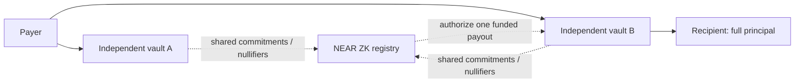

# Money Station — private business settlement on NEAR

[English](README.md) · [한국어](README.ko.md) · [简体中文](README.zh-CN.md)

NEAR 기반 기업 프라이빗 정산: 독립 볼트가 원금을 보관하고, 공유 영지식 노트가 지급을 승인하며, 선택 공개 증빙으로 정산을 확인합니다.

`Core`는 Money Station의 SDK·API·최종화 인덱서·기업 워크플로를 보관하는 저장소입니다.

우분투 배포: [Money Station](https://moneystation.site) · [API 상태](https://api.moneystation.site/readyz). 공개 HTTPS·네이티브 인덱스·최종 출처 CORS·브라우저 연결을 검증했고 비공개 DB·암호화 키와 인증서 갱신을 유지합니다. [운영과 검증 기록](docs/UBUNTU_BACKEND.md).

`/relay/`에서 선택적 지연 실행을 지원합니다. 실행 시간을 한 번 추첨해 저장하고, 배치당 최대 8개의 개별 거래와 대기·취소·만료·원본 요청 복구를 처리합니다. [지연 실행 가이드](https://github.com/Company-privacy-settlement/Core/blob/main/docs/SCHEDULED_DELIVERY.md). 익명성 입증이나 공개 릴레이 운영을 의미하지 않습니다.

지연 실행 검증: **Core 565개 테스트**, **Front 단위 테스트 8개**, 실제 네이티브/FT WASM·Groth16 스케줄링과 데스크톱·모바일 대기·복구·증명 UX를 검증했습니다. 공개 USDC와 외부 HTTPS 릴레이 실증은 별도입니다.

선택적 [Cover traffic 실험](https://github.com/Company-privacy-settlement/Core/blob/main/docs/COVER_TRAFFIC.md)은 테스트넷에서 운영자 소유 네이티브 노트만 사용합니다. 4건이 확정됐고 원금 0.1 NEAR를 운영자에게 회수했습니다. 인공 출금의 전체 이력 출력 후보는 6개, 표시된 인공 출력을 제외하면 3개입니다. 독립 참여자 증가는 **0명**이며 예산·빈도 제한은 재시작 후에도 유지됩니다. 실효 익명성의 증거가 아닙니다.

[결제 보안 점검](https://github.com/Company-privacy-settlement/Core/blob/main/docs/REVIEW-2026-11-14-PAYMENT-SECURITY.md): 정책 메타데이터 차이로 같은 노트가 중복 예약되는 문제와 기존 데이터 충돌을 수정했습니다. 이중 사용·유동성 경쟁·실패 회계·승인 내용 변경·권한 철회를 검증해 **Core 582개**, **컨트랙트 63개 테스트**를 통과했습니다. 기업 승인은 API·SDK에서 집행되며 유효 증명의 온체인 실행은 계속 비허가형입니다.

[실제 제공자 검증](https://github.com/Company-privacy-settlement/Core/blob/main/docs/PROVIDER_QUALIFICATION.md)을 위한 읽기 전용 Sumsub 상태 확인과 원문·외부 서명 검증 도구를 추가했습니다. 공식 원문 해시는 6개 중 4개가 일치했습니다. 실제 계정 설정·허용 케이스·외부 검토 서명이 없어 KYB·세무 제공자 실증은 **미완료**입니다. 비활성화와 실소유자 구조 변경 처리도 수정했습니다.

## 프로젝트 소개

기업은 인보이스 내용과 업무 문서를 온체인에 공개하지 않으면서 공급사·직원·계약자에게 지급해야 합니다. Money Station은 수취인 서명 요청, 로컬 증명과 검토 가능한 증빙을 결합하고 원금 보관을 여러 볼트로 분산합니다.

[Hackathon guide](https://github.com/Company-privacy-settlement/Core/blob/main/docs/HACKATHON.md) · [Web Docs](https://core-private-settlement-0574c4.jiheon6768.chatgpt.site/docs/) · [Core](https://github.com/Company-privacy-settlement/Core) · [Contract](https://github.com/Company-privacy-settlement/Contract) · [Front](https://github.com/Company-privacy-settlement/Front)

## 데모 보기

[](https://github.com/Company-privacy-settlement/Front/blob/main/public/media/money-station-demo-en.mp4)

[Watch English MP4](https://github.com/Company-privacy-settlement/Front/blob/main/public/media/money-station-demo-en.mp4) · [Captions, transcript & chapters](https://github.com/Company-privacy-settlement/Front/blob/main/docs/HACKATHON_DEMO.md) · [Hosted video player](https://core-private-settlement-0574c4.jiheon6768.chatgpt.site/media/)

영문 내레이션·짧은 자막·모션그래픽과 실제 Money Station 화면을 제공합니다. 브라우저 구간은 지갑/API 테스트 환경임을 표시하고 실제 로컬 증명을 생성합니다. 네이티브 NEAR 공개 테스트넷 실증은 아래 문서에 별도로 기록합니다.

저장소·사이트 접근은 기존 권한을 따릅니다. 영상은 Front에 보관되므로 심사자는 Front 접근 권한이나 다운로드 영상 패키지가 필요합니다. 제출 준비로 공유 권한을 변경하지 않습니다.

## 구현한 기능

| 기능 | 구현 |
| --- | --- |
| 가스 대납 | 출금·복구용 비수탁 증명 릴레이, 자체 키 비용 대납과 영속 재전송 차단. |
| 정산 | 네이티브 NEAR v2·토큰 고정 NEP-141/USDC v3, 공유 nullifier와 분산 원금. |
| 로컬 증명 | Groth16 노트 생성·사용, 브라우저 증명 지원, 선택 공개 영수증. |
| 운영 | 읽기 전용 API·최종화 SQLite 인덱서·서비스 감독·배포/릴리스·복구. |
| 기업 | 조직/RBAC·암호화 인보이스·분리 승인·일괄 송금·서명 웹훅. |
| 준비 | KYB 커넥터·미국/아부다비 적용일별 규칙·출처 초안·불변 리비전/독립 검토. |

## 로컬 실행

Node.js 22.16+가 필요하며 타입·테스트·SDK 빌드에는 지갑 키가 필요 없습니다. API·인덱서와 조직 API는 별도 서비스입니다. 실행 전 검토한 정책/RPC와 보호된 저장소를 구성하세요.

```bash
npm ci
npm run check
npm test
npm run build:sdk
```

```bash
# Read-only verification of the recorded real testnet run; no wallet key needed.
npm run testnet:verify-wallet -- docs/evidence/testnet-wallet-2026-11-14.json \
  e009bd0f600b23e0fabe30064ee3211446682946126d1b341aace34b5981a681 \
  /tmp/core-wallet-verification-new.json
```

## 실제 테스트넷 증거

2026-11-14 **실제 공개 테스트넷 거래 14건을 FINAL로 확인**했습니다. 배포·키 제거, 0.1 NEAR 입금 2건, 출금과 수취인 미생성 실패 후 원래 목적지 복구를 검증했습니다. 두 수취인은 각각 원금 0.1 NEAR 전액을 받았고 재시도 프로토콜 수수료는 0입니다. 레지스트리·볼트 2개는 키리스이며, 별도 읽기 전용 검증기로 영수증·서명·과거 입출금 전후 잔액·프로토콜 수수료 합계 0.0006 NEAR를 확인했습니다.

[Testnet run and transaction links](https://github.com/Company-privacy-settlement/Core/blob/main/docs/TESTNET_WALLET.md) · [Public evidence](https://github.com/Company-privacy-settlement/Core/blob/main/docs/evidence/testnet-wallet-2026-11-14.json)

[컨트랙트·볼트 주소](https://core-private-settlement-0574c4.jiheon6768.chatgpt.site/docs/deployments/) · [주소 기록과 검증 핀](https://github.com/Company-privacy-settlement/Core/blob/main/docs/DEPLOYED_ADDRESSES.md). 2026-11-14 FINAL 블록 **277653473**에서 레지스트리와 볼트 2개를 재확인했습니다. 네이티브 NEAR 테스트넷 참조이며 브라우저 USDC 정산과 별도입니다.

네이티브 지갑 실증 시 **Core 513개 테스트**와 SDK·타입 빌드·컴파일 서비스 재시작/백업/복구를 검증했습니다. 브라우저 USDC 준비 업데이트는 **Core 520개 테스트**와 타입 검사를 통과했으나 실제 자금 점검은 차단 상태입니다. 프라이버시 기준선 업데이트는 **Core 535개 테스트**를 통과했으며 재검증한 네이티브 기록을 측정하지만 실효 익명성을 입증하지는 않습니다. 브라우저 테스트 환경·자금 사전 점검·공개 정산 실거래 증거는 구분합니다. 비수탁 릴레이는 **Core 549개 테스트**, 실제 네이티브/FT 샌드박스와 공개 테스트넷 0.1 NEAR 대납 출금을 검증했으며 중복 요청·재시작 시 재전송하지 않았습니다.

## 구조와 수수료



입금·출금 각각 **0.15%를 원금에 추가**합니다. 수취인은 원금 전액을 받습니다. NEAR 작업 저장비·토큰 등록·계정 활성화·네트워크 가스는 별도입니다.

ZK는 사용한 입력 노트의 연결을 숨깁니다. 서명자·수취인·시간·고정 금액·볼트·자금 출처는 공개됩니다. 단일 payer 실증은 실효 익명성의 증거가 아닙니다. 별도 테스트넷 실험 도구는 운영자의 인공 활동을 표시합니다. 그룹당 총 출력 한도는 현재 256개입니다.

## 범위와 다음 단계

**해커톤·개발 프로토타입**입니다. 설정은 `UNSAFE_LOCAL_DEVELOPMENT_ONLY`입니다. 공개 테스트넷 검증 범위는 로컬 Ed25519 소프트웨어 지갑의 네이티브 NEAR입니다. 실제 브라우저 지갑·USDC 실행, 지갑 인증 기반 조직 업무 실증, 원격 Actions 성공과 프로덕션 보안 검토는 남아 있습니다.

다음 우선순위는 외부 호스팅 릴레이 실증, 독립 참여자 확보와 공격자 모델에 따른 추가 프라이버시 측정입니다. 실제 KYB/AI 제공자 운영 검증·전문가 규칙 승인·법정 신고는 별도입니다.

## 프로젝트 살펴보기

[브라우저 USDC 실증](https://github.com/Company-privacy-settlement/Core/blob/main/docs/BROWSER_USDC_TESTNET.md) · [Service](https://github.com/Company-privacy-settlement/Core/blob/main/docs/SERVICE.md) · [프라이버시 기준선](https://github.com/Company-privacy-settlement/Core/blob/main/docs/PRIVACY_BASELINE.md) · [비수탁 릴레이](https://github.com/Company-privacy-settlement/Core/blob/main/docs/RELAY.md) · [Privacy](https://github.com/Company-privacy-settlement/Core/blob/main/docs/PRIVACY.md) · [Invoices](https://github.com/Company-privacy-settlement/Core/blob/main/docs/INVOICE_PAYMENTS.md) · [Organizations](https://github.com/Company-privacy-settlement/Core/blob/main/docs/ORGANIZATIONS.md) · [Tax drafts](https://github.com/Company-privacy-settlement/Core/blob/main/docs/TAX_DRAFTS.md) · [Deployment](https://github.com/Company-privacy-settlement/Core/blob/main/docs/DEPLOYMENT.md) · [Hosting](https://github.com/Company-privacy-settlement/Core/blob/main/docs/PRODUCTION_HOSTING.md) · [CI](https://github.com/Company-privacy-settlement/Core/blob/main/docs/CI.md) · [Roadmap](https://github.com/Company-privacy-settlement/Core/blob/main/docs/ROADMAP.md)
