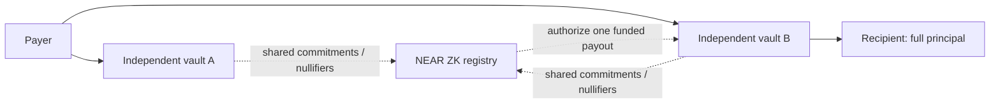

# Core — private business settlement on NEAR

[English](README.md) · [한국어](README.ko.md) · [简体中文](README.zh-CN.md)

基于 NEAR 的企业隐私结算：独立金库持有本金，共享零知识票据授权付款，选择披露证据用于对账。

Core 仓库提供 SDK、API、最终化索引器和企业工作流。

## 项目简介

企业需要向供应商、员工和承包商付款，同时避免将发票条款及业务文档公开上链。Core 结合收款人签名请求、本地证明和可审核证据，并将本金分布在独立金库中。

[Hackathon guide](https://github.com/Company-privacy-settlement/Core/blob/main/docs/HACKATHON.md) · [Web Docs](https://core-private-settlement-0574c4.jiheon6768.chatgpt.site/docs/) · [Core](https://github.com/Company-privacy-settlement/Core) · [Contract](https://github.com/Company-privacy-settlement/Contract) · [Front](https://github.com/Company-privacy-settlement/Front)

## 观看演示

[](https://github.com/Company-privacy-settlement/Front/blob/main/public/media/core-hackathon-demo-en.mp4)

[Watch English MP4](https://github.com/Company-privacy-settlement/Front/blob/main/public/media/core-hackathon-demo-en.mp4) · [Captions, transcript & chapters](https://github.com/Company-privacy-settlement/Front/blob/main/docs/HACKATHON_DEMO.md) · [Hosted video player](https://core-private-settlement-0574c4.jiheon6768.chatgpt.site/media/)

提供英文旁白、字幕及真实应用画面。浏览器片段标明钱包/API 测试环境，并生成真实本地证明。独立章节展示已记录的原生 NEAR 公开测试网验证。

仓库与站点保留现有访问权限。视频位于 Front；评审需要 Front 权限或下载的视频包。本次提交准备不改变共享范围。

## 已实现功能

| 能力 | 实现 |
| --- | --- |
| 结算 | 原生 NEAR v2、绑定代币的 NEP-141/USDC v3、共享 nullifier 与分布式本金。 |
| 本地证明 | Groth16 票据生成/花费、浏览器证明支持及选择披露收据。 |
| 运营 | 只读 API、最终化 SQLite 索引器、服务监督、部署/发布与恢复。 |
| 企业 | 组织/RBAC、加密发票、独立审批、批量付款和签名 webhook。 |
| 准备 | KYB 连接器、美国/阿布扎比生效日期规则、附来源草稿及不可变修订/独立审核。 |

## 本地运行

需要 Node.js 22.16+。类型、测试及 SDK 构建无需钱包密钥。API/索引器与组织 API 为独立服务；启动前配置审核过的策略/RPC 和受保护存储。

```bash
npm ci
npm run check
npm test
npm run build:sdk
```

```bash
# Read-only verification of the recorded real testnet run; no wallet key needed.
npm run testnet:verify-wallet -- docs/evidence/testnet-wallet-2026-11-14.json \
  e009bd0f600b23e0fabe30064ee3211446682946126d1b341aace34b5981a681 \
  /tmp/core-wallet-verification-new.json
```

## 真实测试网证据

2026-11-14 确认 **14 笔真实公开测试网交易达到 FINAL**：部署/移除密钥、两笔 0.1 NEAR 入金、付款，以及收款账户不存在后向原目的地恢复。两名收款人均收到完整 0.1 NEAR，重试无第二次协议费。注册表与两个金库均无访问密钥；独立只读验证程序重新查询收据、签名、历史前后余额及合计 0.0006 NEAR 协议费。

[Testnet run and transaction links](https://github.com/Company-privacy-settlement/Core/blob/main/docs/TESTNET_WALLET.md) · [Public evidence](https://github.com/Company-privacy-settlement/Core/blob/main/docs/evidence/testnet-wallet-2026-11-14.json)

原生钱包实证记录通过了 **Core 513 项测试**、SDK/类型构建和编译服务重启/备份/恢复验证。浏览器 USDC 准备更新通过了 **Core 520 项测试**与类型检查，但实际资金预检仍被阻塞。浏览器测试环境、资金预检和公开结算执行是不同的证据类别。

## 架构与费用



入金与出金各在本金之外加收 **0.15%**。收款人收到完整本金。NEAR 操作存储、代币注册、账户激活及网络 gas 单独计算。

ZK 隐藏使用了哪一张输入票据。签名人、收款人、时间、固定金额、金库及资金来源仍公开。单一付款人测试不证明有效匿名性。当前无 cover traffic 调度，每组总输出上限为 256。

## 范围与后续工作

**黑客松/开发原型**，设置为 `UNSAFE_LOCAL_DEVELOPMENT_ONLY`。公开测试网验证仅覆盖本地 Ed25519 软件钱包的原生 NEAR。真实浏览器钱包/USDC、外部 API HTTPS 验收、远程 Actions 成功及生产安全审核尚待完成。

下一步优先非托管中继、自愿随机延迟/批处理、隐私测量，再评估有预算限制的 cover traffic。真实 KYB/AI 服务资格、专业规则批准和法定申报仍需独立验证。

## 探索项目

[浏览器 USDC 验证](https://github.com/Company-privacy-settlement/Core/blob/main/docs/BROWSER_USDC_TESTNET.md) · [Service](https://github.com/Company-privacy-settlement/Core/blob/main/docs/SERVICE.md) · [Privacy](https://github.com/Company-privacy-settlement/Core/blob/main/docs/PRIVACY.md) · [Invoices](https://github.com/Company-privacy-settlement/Core/blob/main/docs/INVOICE_PAYMENTS.md) · [Organizations](https://github.com/Company-privacy-settlement/Core/blob/main/docs/ORGANIZATIONS.md) · [Tax drafts](https://github.com/Company-privacy-settlement/Core/blob/main/docs/TAX_DRAFTS.md) · [Deployment](https://github.com/Company-privacy-settlement/Core/blob/main/docs/DEPLOYMENT.md) · [Hosting](https://github.com/Company-privacy-settlement/Core/blob/main/docs/PRODUCTION_HOSTING.md) · [CI](https://github.com/Company-privacy-settlement/Core/blob/main/docs/CI.md) · [Roadmap](https://github.com/Company-privacy-settlement/Core/blob/main/docs/ROADMAP.md)
