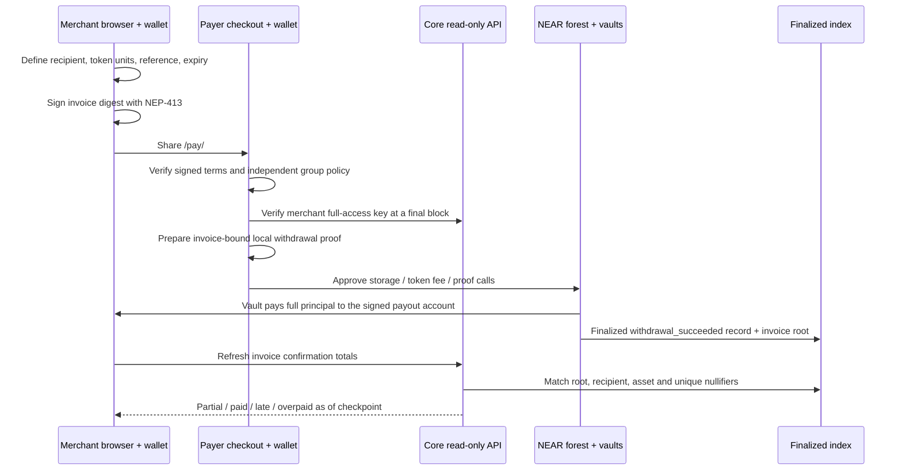

# Recipient-issued invoices and private checkout

Core now supports a recipient-led payment flow: the merchant signs an invoice, shares a checkout link, the payer reviews and signs private-settlement calls, and the merchant reconciles finalized payouts against that invoice.

CoinGate's [order → payment URL](https://developer.coingate.com/reference/create-order) and [payment-state notification](https://developer.coingate.com/reference/payment-callback) flows inform the user journey. Core's first version uses a signed request carried by the client and read-only settlement queries. It does not integrate CoinGate, perform currency conversion, or maintain a merchant custody balance.

## Flow



The protocol holds no invoice-operator signing key and collects no principal in a central merchant wallet. Existing keyless vault settlement, global nullifiers and fixed-destination recovery keep their behavior. Invoice business terms are not saved by the Core API.

## What the first version implements

| Part | Implemented behavior |
| --- | --- |
| Issue | Front `/invoices/`: trusted FT policy, merchant wallet, payout account, title/reference, 1–32 payment units and expiry |
| Authorize | Ed25519 NEP-413 signature over the invoice digest and network; current on-chain FullAccess key check |
| Share | Signed JSON download and a `/pay/#invoice=...` link, with the terms in the fragment |
| Checkout | Local signature verification, independently trusted group policy, merchant verification and invoice-bound public plan import |
| Pay | Existing local proof generation, encrypted wallet-operation journal, one reviewed wallet call at a time and fixed-destination recovery |
| Reconcile | Read-only indexed confirmations matched to the invoice root, recipient, pinned token and denomination; unique successful nullifiers only |
| Export | Signed request and indexed settlement summary; neither is labeled a tax certificate |

The merchant page is client-held: download the signed JSON before leaving. Open that file to inspect/track it later. It does not silently persist business terms in localStorage or a server database. Sharing visibility follows the hosting site's access settings; the existing Sites preview remains owner-private. External customer checkout requires hosting/access appropriate to those customers.

## Signed terms and chain binding

`Invoice` v1 contains `id`, `merchantAccount`, `recipient`, `title`, `reference`, exact `policy`, `units`, UTC `createdAt`/`expiresAt` and a fresh 32-byte random `nonce`. `version` is fixed to 1. Amounts derive from the trusted group's denomination; the request cannot swap the token, registry, fee recipient or reviewed code/verifier hashes. Unknown fields are rejected.

```text
invoiceHash    = SHA256("core:invoice:v1|" + canonical(invoice))
settlementRoot = SHA256("core:invoice:settlement:v1|" + invoiceHash)
```

The merchant signs this NEP-413 message:

```text
Core invoice v1
Network: testnet
Digest: <invoiceHash>
```

The NEP recipient is `core.invoice.v1`; the invoice nonce is the 32-byte NEP nonce, and the callback option is `None`. The signature follows the standard Borsh tag `2^31 + 413` and SHA-256/Ed25519 encoding. Wallets must support compatible NEP-413 message signing. Unsupported/missing results fail rather than issuing an unsigned invoice. Invoice issuance does not request a transaction or application access key.

Browser verification checks the signature and all signed terms. `POST /v1/invoices/verify` additionally reads the named merchant account's keys at one final block and requires that exact key's permission to be `FullAccess`. A valid signature under an unrelated key, removed key or function-call key does not pass. The payout account may differ from the merchant signer because the signed request explicitly authorizes that destination. Wallet control is **not** legal-entity identity or KYB. Current-key verification can stop new checkout after key removal; historical key/issuer attestations are a later integration.

A payer's withdrawal proof must use `recipient = invoice.recipient` and `disclosureRoot = settlementRoot`. Existing v3 action context binds these values, the chosen vault, registry, token and denomination. Importing a valid proof for another invoice/root or recipient is rejected by checkout. Reusing one completed nullifier cannot increase the confirmed invoice amount. Different invoices receive independent random IDs/nonces and roots, even when their human references happen to match.

## Amount and fee model

The current privacy protocol uses fixed denominations. Invoice principal is `units × denomination`, with 1–32 units per invoice. There is no decimal fiat quote, FX lock or arbitrary fractional amount in this version. Choose a reviewed group with the denomination needed for the invoice.

For a 1 USDC group (six decimals), a two-unit invoice requests **2,000,000 atomic units = 2 USDC**. Two withdrawals charge **3,000 atomic units = 0.003 USDC** in protocol fees, on top of principal; the merchant receives the full 2 USDC. Fee rounding happens per note. NEAR storage/first-use credit bonds/token registration and network gas are separate. A payer who must first create private notes also pays the existing deposit-side 0.15% fee. The merchant's off-chain invoice signature itself charges no protocol fee or gas.

Payers currently generate private notes/proofs locally with the Core CLI. The browser checkout executes prepared public FT withdrawal plans; it does not create new Groth16 proofs or accept private note files. It supports repeated per-note payments for multi-unit invoices. No easy wallet-only/fiat checkout is implied.

## Run a private invoice payment

Run the verified Core API and index worker as described in [INDEXER.md](INDEXER.md), using a real deployment policy and exact Front CORS origin. No public deployment/funded account is bundled.

1. On Front `/invoices/`, import an independently obtained testnet FT policy and enter the matching API origin.
2. Connect the merchant wallet, review the payout account/price/expiry, and choose **Sign & create payment link**. Download the signed invoice.
3. Share the link/file through a suitable channel. Anyone holding it can read its title/reference and signed payment terms.
4. The payer opens checkout, independently imports the trusted group policy, verifies the merchant, connects their wallet and unlocks their encrypted operation journal.
5. Prepare an action locally and generate one withdrawal plan per private note:

```sh
npm run cli -- invoice-action trusted-policy.json signed-invoice.json invoice-action.json
npm run cli -- shared-spend-args trusted-policy.json https://rpc.testnet.near.org \
  encrypted-note.json invoice-action.json public-invoice-payment.json
```

`invoice-action` validates the local signature, policy and open time; merchant on-chain key ownership is checked by checkout before signing. A failed/missing API verification must not be replaced with trusting the included key. Existing CLI password handling stays in `CORE_NOTE_PASSWORD`; private note files stay on the payer's device. Front can also download the same public proof action.

6. Import `public-invoice-payment.json` into checkout. Approve each prerequisite/payment. Refresh the merchant's indexed invoice status as the worker observes completed payouts. Repeat for the required units.
7. Export the indexed summary for reconciliation. Existing evidence bundles can independently verify selected linked transaction records. The request signature proves its terms; the index observations report settlement. Neither proves legal identity, complete company history or tax filing acceptance.

## State model

| State | Meaning at the reported index checkpoint |
| --- | --- |
| `awaiting_payment` | No matching confirmed principal indexed, deadline open |
| `partial` | Some principal confirmed; amount remains and deadline open |
| `paid` | Exactly the requested principal confirmed before expiry |
| `paid_late` | Exactly the requested principal, with payment at/after expiry |
| `overpaid` | More principal confirmed than requested; merchant reconciliation needed |
| `expired` | Deadline passed with no matching indexed principal |
| `partial_expired` | Deadline passed with an outstanding balance |
| `review_required` | The known journal or bounded confirmation scan is incomplete |

Only `withdrawal_succeeded` records with the exact root, recipient and asset count. Deposit, request, failure and retry events do not count. Identical nullifiers are counted once. Block timestamps determine late settlement; refreshing an old invoice after its deadline does not turn an already timely paid invoice into an expired one.

Checkout blocks new imports/signatures after expiry or a fully covered/review-needed invoice. Recovery of an already committed operation keeps the original destination and remains possible after expiry. Expiry is a browser/application rule: the existing contracts do **not** enforce invoice deadlines, cancellation, expected unit caps or a global invoice-paid flag. An already signed transaction can settle late, and simultaneous independent payers can overpay. Those cases remain visible and require merchant handling; the application never invents an automatic refund or resets a nullifier.

Status is indexed history with `chainFreshnessChecked: false`, not a latest-chain assertion. The response includes the index height/time, confirmed principal, remaining/excess/late totals and selected confirmation references. A wallet approval, callback, redirect or transaction acceptance alone never sets `paid`. Re-query after indexer lag. Invoice status reads are bounded and do not mutate invoice or settlement state.

## API and privacy boundary

| Endpoint | Accepted public input |
| --- | --- |
| `POST /v1/invoices/verify` | `invoiceHash`, merchant account, nonce, public key and signature |
| `POST /v1/invoices/status` | `invoiceHash`, payout recipient, unit count and expiry |
| `GET /v1/activity?disclosure_root=...` | Existing public activity query with an indexed commitment filter |

Full titles, human references and business documents are not sent to these endpoints. Unknown fields, including accidentally supplied private material, are rejected. The API has no invoice-create write route, custody key, sender broadcast route or arbitrary merchant callback target. It can still observe public invoice lookups and addresses. URL fragments are not sent in the page's HTTP request, but link holders, browser extensions and page code can see their contents; a fragment is not encrypted storage.

The on-chain root commits to the salted request. Public recipients, token amounts, timing, nullifiers and the common root can link parts of one invoice. This intentional reconciliation link does not hide network activity or guarantee anonymity beyond the existing input-note proof. Keep legal names, payroll documents and tax forms in separately encrypted business-document storage, a later integration.

SQLite adds a disclosure-root column/index through an additive writer migration. Run the updated worker before attaching an existing database to new invoice routes. The API remains read-only.

## Next merchant-service layer

For a production merchant gateway, add an authenticated invoice API with encrypted business terms, durable merchant-owned invoice IDs, immutable terms and audit history. Keep it separate from keyless settlement authority. A webhook worker should consume independently verified final events, write an idempotent outbox, and send signed notifications with bounded retries to reviewed destinations. Merchant systems must re-check status and deduplicate fulfillment. An HTTP return/success URL must never authorize paid status.

Also outstanding: indexed-provider scaling, browser proof generation, account/FT activation UX, independent security review, explicit cancellation/reservation semantics, merchant-controlled refunds, real KYB providers, jurisdiction-specific invoice/tax preparation, fiat conversion and public-network operations. These are not advertised as implemented by this MVP.

## Validation

Core tests cover independent NEP-413 serialization, term tampering, UTF-8 links, full-access ownership, additive fees, expiry/partial/late/overpayment, nullifier deduplication, incomplete indexing, strict APIs and invoice-bound plan checks. Browser tests issue a request with a standard injected fixture wallet, open its fragment checkout, reject a different invoice proof, and reconcile two simulated wallet settlements. The actual sandbox integration verifies a recipient-issued merchant signature against live account keys, pays an invoice-bound withdrawal after recovery, and reconciles its finalized principal through the real index/API. The token in that integration is a sandbox fixture, not Circle-issued USDC.

References: [NEP-413](https://github.com/near/NEPs/blob/master/neps/nep-0413.md), [Core wallet execution](WALLET.md), [Core index](INDEXER.md), [CoinGate create-order flow](https://developer.coingate.com/reference/create-order).
