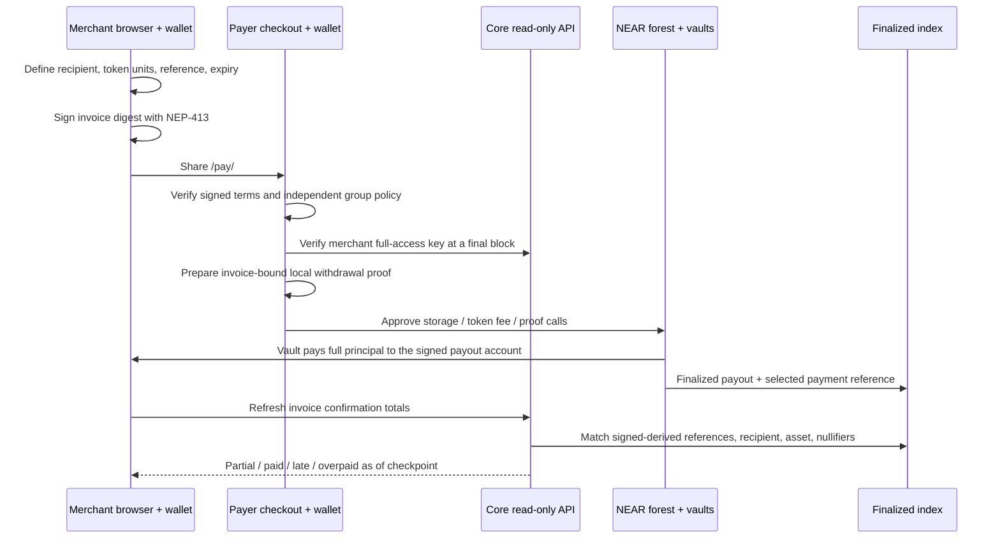

# Recipient-issued invoices and private checkout

[Service overview](SERVICE.md) · [Development roadmap](ROADMAP.md)

Money Station now supports a recipient-led payment flow: the merchant signs an invoice, shares a checkout link, the payer reviews and signs private-settlement calls, and the merchant reconciles finalized payouts against that invoice.

CoinGate's [order → payment URL](https://developer.coingate.com/reference/create-order) and [payment-state notification](https://developer.coingate.com/reference/payment-callback) flows inform the user journey. Core's first version uses a signed request carried by the client and read-only settlement queries. It does not integrate CoinGate, perform currency conversion, or maintain a merchant custody balance.

## Flow



The protocol holds no invoice-operator signing key and collects no principal in a central merchant wallet. Existing keyless vault settlement, global nullifiers and fixed-destination recovery keep their behavior. Invoice business terms are not saved by the public settlement API. The separate [Organization invoice API](ORGANIZATION_INVOICES.md) can persist signed terms with tenant authorization, idempotency and encryption at rest.

## Implemented flow

| Part | Implemented behavior |
| --- | --- |
| Issue | Front `/invoices/`: trusted FT policy, merchant wallet, payout account, title/reference, 1–32 payment units and expiry |
| Authorize | Ed25519 NEP-413 signature over the invoice digest and network; current on-chain FullAccess key check |
| Share | Signed JSON download and a `/pay/#invoice=...` link, with the terms in the fragment |
| Checkout | Local signature verification, independently trusted group policy, merchant verification and invoice-bound public plan import |
| Pay | Existing local proof generation, encrypted wallet-operation journal, one reviewed wallet call at a time and fixed-destination recovery |
| Reconcile | Read-only indexed confirmations matched to the signed reference set, recipient, pinned token and denomination; unique successful nullifiers only |
| Export | Signed request and indexed settlement summary; neither is labeled a tax certificate |

The merchant page is client-held. Explicitly save a request to the optional [encrypted invoice library](INVOICE_LIBRARY.md), or download its signed JSON before leaving. Signing alone does not persist it. The library keeps encrypted terms in the browser and supports account-separated search, backups and immutable merging; Core has no merchant invoice database. Sharing visibility follows the hosting site's access settings; the existing Sites publication remains owner-private. External customer checkout requires hosting/access appropriate to those customers.

## Signed terms and chain binding

New `Invoice` terms v2 contain `id`, `merchantAccount`, `recipient`, `title`, `reference`, exact `policy`, `units`, UTC `createdAt`/`expiresAt`, a fresh 32-byte signing `nonce`, and one distinct random 32-byte `paymentNonces` entry per unit. Unknown fields are rejected. Amounts derive from the independently trusted group; terms cannot swap its token, registry, fee recipient or reviewed code/verifier hashes.

```text
invoiceHash    = SHA256("core:invoice:v2|" + canonical(invoice))
settlementRoot[i] = SHA256("core:invoice:payment:v2|" + invoiceHash + "|" + paymentNonces[i])
```

Each unit publishes a different reference. SDK `invoiceRoot(invoice, zeroBasedIndex)` requires an explicit index for multi-unit v2 invoices. `invoicePaymentRoots` returns the signed-derived set. Existing v1 terms retain their original digest `SHA256("core:invoice:v1|" + canonical(invoice))` and common reference `SHA256("core:invoice:settlement:v1|" + invoiceHash)`; they are not silently upgraded. Terms v2 use the existing **signing envelope v1**:

The merchant signs this NEP-413 message:

```text
Core invoice v1
Network: testnet
Digest: <invoiceHash>
```

The NEP recipient is `core.invoice.v1`; the invoice nonce is the 32-byte NEP nonce, and the callback option is `None`. The signature follows the standard Borsh tag `2^31 + 413` and SHA-256/Ed25519 encoding. Wallets must support compatible NEP-413 message signing. Unsupported/missing results fail rather than issuing an unsigned invoice. Invoice issuance does not request a transaction or application access key.

Browser verification checks the signature and all signed terms. `POST /v1/invoices/verify` additionally reads the named merchant account's keys at one final block and requires that exact key's permission to be `FullAccess`. A valid signature under an unrelated key, removed key or function-call key does not pass. The payout account may differ from the merchant signer because the signed request explicitly authorizes that destination. Wallet control is **not** legal-entity identity or KYB. Current-key verification can stop new checkout after key removal; historical key/issuer attestations are a later integration.

A payer's withdrawal proof must use `recipient = invoice.recipient` and `disclosureRoot = settlementRoot[i]` (one of the signed-derived references). Existing v3 action context binds these values, the chosen vault, registry, token and denomination. Importing a valid proof for another invoice/root or recipient is rejected by checkout. An arbitrary [business receipt root](BROWSER_RECEIPTS.md) cannot replace this signed-derived unit root. The current action has one disclosure reference; combining invoice binding with arbitrary receipt evidence needs a separately designed/versioned commitment. Receipt integrity alone does not establish invoice payment. Reusing one completed nullifier cannot increase the confirmed invoice amount. Different invoices receive independent random IDs/nonces and roots, even when their human references happen to match.

## Amount and fee model

The current privacy protocol uses fixed denominations. Invoice principal is `units × denomination`, with 1–32 units per invoice. There is no decimal fiat quote, FX lock or arbitrary fractional amount in this version. Choose a reviewed group with the denomination needed for the invoice.

For a 1 USDC group (six decimals), a two-unit invoice requests **2,000,000 atomic units = 2 USDC**. Two withdrawals charge **3,000 atomic units = 0.003 USDC** in protocol fees, on top of principal; the merchant receives the full 2 USDC. Fee rounding happens per note. NEAR storage/first-use credit bonds/token registration and network gas are separate. A payer who must first create private notes also pays the existing deposit-side 0.15% fee. The merchant's off-chain invoice signature itself charges no protocol fee or gas.

Payers create FT notes and verify encrypted backups locally in [Private notes](BROWSER_NOTES.md), or use the Core CLI. [Connected checkout](INVOICE_PAYMENTS.md) opens an original-group encrypted note, derives the selected signed unit reference, generates and verifies its proof locally, then imports only the public plan for explicit fee review and wallet approval. The [standalone prover](BROWSER_PROVER.md) and CLI remain alternatives. Repeat with distinct notes and unit references for multi-unit invoices. No fiat checkout is implied.

## Run a private invoice payment

Run the verified Core API and index worker as described in [INDEXER.md](INDEXER.md), using a real deployment policy and exact Front CORS origin. No public deployment/funded account is bundled.

1. On Front `/invoices/`, import an independently obtained testnet FT policy and enter the matching API origin.
2. Connect the merchant wallet, review the payout account/price/expiry, and choose **Sign & create payment link**. Download the signed invoice.
3. Share the link/file through a suitable channel. Anyone holding it can read its title/reference and signed payment terms.
4. The payer opens checkout, independently imports the trusted group policy, verifies the merchant, connects their wallet and unlocks their encrypted operation journal.
5. Select a payment unit, open its original-group encrypted note and import independently trusted proving files/hash. Choose **Generate invoice proof**, then **Review amount & fees**. See the [connected payment guide](INVOICE_PAYMENTS.md) for cancellation, local duplicate checks and recovery. Alternatively, prepare the public plan with the CLI:

```sh
npm run cli -- invoice-action trusted-policy.json signed-invoice.json invoice-action.json 1
npm run cli -- shared-spend-args trusted-policy.json https://rpc.testnet.near.org \
  encrypted-note.json invoice-action.json public-invoice-payment.json
```

`invoice-action` validates the local signature, policy and open time; merchant on-chain key ownership is checked by checkout before signing. A failed/missing API verification must not be replaced with trusting the included key. Existing CLI password handling stays in `CORE_NOTE_PASSWORD`; private note files stay on the payer's device. The final CLI argument selects a **1-based payment unit**, required for multi-unit v2 invoices. Choose 2 for the next unit, and so on. Front’s Payment unit selector downloads the corresponding public proof action. Legacy v1 and single-unit v2 accept the original three-file command.

6. For CLI output, import `public-invoice-payment.json` with the matching unit selected. Review the full principal, additive 0.15% fee and separate NEAR costs, then approve each prerequisite/payment individually. Checkout observes the bound finalized record with bounded read-only polling; invoice totals are indexed separately and may lag. Repeat with a different note for each required unit.
7. Export the indexed summary for reconciliation. Existing evidence bundles can independently verify selected linked transaction records. The request signature proves its terms; the index observations report settlement. Neither proves legal identity, complete company history or tax filing acceptance.

## State model

| State | Meaning at the reported index checkpoint |
| --- | --- |
| `awaiting_payment` | No matching confirmed principal indexed, deadline open |
| `partial` | Some principal confirmed; amount remains and deadline open |
| `paid` | Exactly the requested principal confirmed before expiry |
| `paid_late` | Exactly the requested principal, with payment at/after expiry |
| `overpaid` | More principal confirmed than requested; merchant reconciliation needed |
| `expired` | Deadline passed with no matching indexed principal |
| `partial_expired` | Deadline passed with an outstanding balance |
| `review_required` | The known journal or bounded confirmation scan is incomplete |

Only `withdrawal_succeeded` records with a root in the signed-derived set and the exact recipient and asset count. Deposit, request, failure and retry events do not count. Identical nullifiers are counted once. Block timestamps determine late settlement; refreshing an old invoice after its deadline does not turn an already timely paid invoice into an expired one.

Checkout blocks new imports/signatures after expiry or a fully covered/review-needed invoice. Recovery of an already committed operation keeps the original destination and remains possible after expiry. Expiry is a browser/application rule: the existing contracts do **not** enforce invoice deadlines, cancellation, expected unit caps or a global invoice-paid flag. An already signed transaction can settle late, and simultaneous independent payers can overpay. Those cases remain visible and require merchant handling; the application never invents an automatic refund or resets a nullifier.

Checkout clears its displayed and parent payment status while refreshing, after a failed read, or when API/trusted-deployment settings change. Responses from an invalidated read cannot restore prior verification. New payment-plan imports require a successful new status read; recovery keeps its existing bound behavior. An invoice index read failure returns `503 INDEX_READ_FAILED`, with database diagnostics omitted.

Status is indexed history with `chainFreshnessChecked: false`, not a latest-chain assertion. The response includes the index height/time, confirmed principal, remaining/excess/late totals and selected confirmation references. A wallet approval, callback, redirect or transaction acceptance alone never sets `paid`. Re-query after indexer lag. Invoice status reads are bounded and do not mutate invoice or settlement state.

## API and privacy boundary

| Endpoint | Accepted public input |
| --- | --- |
| `POST /v1/invoices/verify` | `invoiceHash`, merchant account, nonce, public key and signature |
| `POST /v1/invoices/status` | v1: `invoiceHash`, `recipient`, `units`, `expiresAt`; v2 additionally: `version: 2`, `paymentNonces` |
| `GET /v1/activity?disclosure_root=...` | Existing public activity query with an indexed commitment filter |

Full titles, human references and business documents are not sent to these endpoints. Unknown fields, including accidentally supplied private material, are rejected. The API has no invoice-create write route, custody key, sender broadcast route or arbitrary merchant callback target. It can still observe public invoice lookups and addresses. URL fragments are not sent in the page's HTTP request, but link holders, browser extensions and page code can see their contents; a fragment is not encrypted storage.

New v2 payments avoid a shared public invoice root. Public recipient reuse, token amounts, timing, signers and nullifiers still permit correlation. Link holders and the API can derive all the invoice's references. This reduces explicit identifier reuse; it does not guarantee transaction-graph anonymity. Keep legal names, payroll documents and tax forms in separately encrypted business-document storage, a later integration. See [the full privacy model](PRIVACY.md).

V2 status responses set `settlementRoot: null`, return `settlementRoots` in signed unit order, include `settlementRoot` on each confirmation, and report `reusedPaymentReferences`. V1 keeps its original shape and common root. The SDK checks that the returned reference set matches the signed terms and that the late-payment total equals the per-confirmation late flags. Run the updated API with the updated Front SDK; an older API rejects v2 status fields.

Checkout rejects a v2 reference already observed as paid before a new import/signature. This is an indexed client guard, not an on-chain reservation. Different nullifiers can race on one reference; their actual payouts are counted and reuse is reported. V2 status uses `IndexStore.invoiceActivity` to query the signed reference set directly with the existing SQLite disclosure-root index, exact recipient and completed-payout kind. Reference-bound cursors preserve a record upper bound across pages. Up to 20 pages of 50 matching records are examined; unrelated recipient payments no longer consume that budget. Older index adapters without this optional method retain the conservative recipient-scan fallback. Reaching incomplete coverage yields `review_required`, never an invented complete status. V1 retains its root-filtered scan.

SQLite adds a disclosure-root column/index through an additive writer migration. Run the updated worker before attaching an existing database to new invoice routes. The API remains read-only.

## Next merchant-service layer

For a production merchant gateway, add an authenticated invoice API with encrypted business terms, durable merchant-owned invoice IDs, immutable terms and audit history. Keep it separate from keyless settlement authority. A webhook worker should consume independently verified final events, write an idempotent outbox, and send signed notifications with bounded retries to reviewed destinations. Merchant systems must re-check status and deduplicate fulfillment. An HTTP return/success URL must never authorize paid status.

Also outstanding: indexed-provider scaling, connected note-to-invoice browser proving, account-activation funding/creation UX beyond the implemented [recipient readiness checks](RECIPIENTS.md), independent security review, explicit cancellation/reservation semantics, merchant-controlled refunds, real KYB providers, jurisdiction-specific invoice/tax preparation, fiat conversion and public-network operations. These are not advertised as implemented by this MVP.

## Validation

Core tests cover independent NEP-413 serialization, term tampering, UTF-8 links, full-access ownership, additive fees, expiry/partial/late/overpayment, nullifier deduplication, incomplete indexing, strict APIs and invoice-bound plan checks. Browser tests issue a request with a standard injected fixture wallet, open its fragment checkout, reject a different invoice proof, and reconcile two simulated wallet settlements. The actual sandbox integration verifies a recipient-issued merchant signature against live account keys, pays an invoice-bound withdrawal after recovery, and reconciles its finalized principal through the real index/API. The token in that integration is a sandbox fixture, not Circle-issued USDC.

References: [NEP-413](https://github.com/near/NEPs/blob/master/neps/nep-0413.md), [Core wallet execution](WALLET.md), [Core index](INDEXER.md), [CoinGate create-order flow](https://developer.coingate.com/reference/create-order).

## Payment management dashboard

[Organization payment dashboard](PAYMENT_DASHBOARD.md) provides complete-snapshot search, state/asset/group/date filters, CSV/JSON export and finalized-index payment observations in Front `/organization/` → Invoice payments. Signed JSON can be explicitly saved to organization storage. Local creation remains independent. Unknown, stale and incomplete observations remain explicit; exports require current read access.
