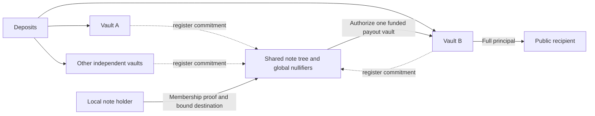

# Privacy model and distributed custody

[Service overview](SERVICE.md) · [Browser receipts](BROWSER_RECEIPTS.md) · [Invoices](INVOICES.md)

## Settlement structure

Each reviewed group has independent keyless vaults and one immutable forest. Deposit principal stays in the selected vault; the forest maintains a shared Poseidon note tree, spent nullifiers and payout reservations. A holder proves a right in that shared tree and can withdraw from one verified vault with sufficient liquidity. The payout goes directly from that vault to the proof-bound recipient. Principal does not travel through an A → B → C chain.

Private note transfers append new commitments without moving backing between vaults. Creating more vaults distributes custody and liquidity; it does not create additional independent participants or guarantee a larger effective anonymity set. The current tree supports 256 total outputs, including transfers, per group. Separate groups and assets are separate proof domains.



## What is hidden and visible

Groth16 proves membership and correct spending without naming the input commitment in the withdrawal. Global nullifiers prevent the same note being paid twice. The action context binds the vault, recipient and disclosure reference; retries retain that original destination.

Public observers can still see deposited commitments, vault funding and balances, transaction signers, token/denomination, payout vault, recipient, amounts, timing, nullifiers and disclosure references. NEAR cross-contract receipts are public. A small group, address reuse, matching timing, funding provenance or voluntary disclosures can correlate deposits and payouts. The protocol does not measure an effective anonymity set, generate recipient EOAs automatically, hide all transaction metadata or provide network-layer anonymity. More public hops alone would not remove these signals.

The read-only API, RPC provider, hosting provider and holders of a signed invoice may observe additional associations. The API has no settlement signing authority, but its observation of lookup metadata is still a privacy boundary. A fragment checkout link keeps terms out of the initial HTTP URL request; page code, extensions and link holders can read them.

## Invoice terms v2

New invoices contain a fresh signing nonce and one distinct random 32-byte `paymentNonces` entry per fixed-denomination unit. The merchant signs all terms, including the ordered nonce list. Given canonical parsed terms:

```text
invoiceHash = SHA256("core:invoice:v2|" + canonical(invoice))
paymentRoot[i] = SHA256("core:invoice:payment:v2|" + invoiceHash + "|" + paymentNonces[i])
```

Each proof uses its selected `paymentRoot[i]` as `disclosure_root`. Different units no longer publish a shared invoice root. The signed invoice ID/hash and full nonce list are not added to settlement calls. This removes a direct common identifier; a reused recipient, matching amount and timing can still associate the payments. Anyone with the invoice or its status request can derive the entire reference set. Status queries give that set's derivation inputs to the API. This is not a zero-knowledge invoice reconciliation service.

Invoice terms v1 remain readable with their original common root. Terms v2 retain the NEP-413 **signing envelope v1** (`core.invoice.v1`, message `Core invoice v1`); the versioned digest authenticates the new terms. The contract ABI, circuit and note domains do not change.

Checkout checks fresh indexed status before importing/signing a new payment, rejecting a reference already observed as paid. These references are not reserved or enforced as single-use on chain. Lag or simultaneous payers can reuse one reference with different nullifiers. Those are real payments: reconciliation counts them and reports `reusedPaymentReferences`. It does not discard money to preserve a preferred privacy claim. Recovery retains the original reference and recipient, including after invoice expiry.

V2 reconciliation uses an internal SQLite reference-set lookup: recipient, completed-withdrawal kind and up to 32 signed-derived references are filtered through the existing disclosure-root index. Cursors bind the reference set, database generation and record upper bound, so later appends cannot enter an existing page sequence. The 20-page, 50-record budget applies to matching records; unrelated recipient history does not consume it. Older `ActivityReader` adapters without `invoiceActivity` retain the bounded recipient-scan fallback. Incomplete indexing or exhausted matching-record coverage still yields `review_required`. An index checkpoint never asserts latest-chain freshness.

## Evidence and limits

The optional [invoice library](INVOICE_LIBRARY.md) stores signed business terms locally under account/network-specific AES-GCM encryption. Save/search/open/backup operations make no API requests and store no payment-status cache. It is separate from private-note backups and the wallet-operation journal. Shared payment links and individually exported signed JSON still disclose their signed terms to holders.

[Browser Evidence](BROWSER_RECEIPTS.md) creates salted receipt commitments, separate encrypted full backups and explicitly selected field openings. Its local verifier requires an independently supplied root and makes no chain request. CLI finalized evidence checks selected public transaction records separately. An arbitrary receipt root cannot replace a signed invoice unit reference; a combined invoice/business-evidence commitment requires a separately designed format. Neither establishes that every company transaction was disclosed, that a merchant is KYB-verified, or that a tax return is accepted. Keep legal names, payroll documents and statutory forms in separately encrypted business-document storage; such a provider is not implemented here. Sharing evidence can intentionally reveal associations to its recipient.

This is a local/testnet hackathon implementation with a development trusted setup and no production security audit. Native CLI public-testnet execution and browser proof generation have separate dated evidence. Larger trees, scalable private reconciliation, real browser-wallet USDC execution and live KYB/tax provider qualification remain separate work. See [invoice behavior](INVOICES.md), [index coverage](INDEXER.md) and the [contract specification](https://github.com/Company-privacy-settlement/Contract/blob/main/docs/SHARED.md).

## Participation and cover traffic

Privacy depends on plausible independent activity in the same proof domain, not the number of accounts controlled by one operator. The public-testnet fixture uses one payer for deposits and withdrawals; public signers/funding/timing remain correlated and this run does not establish effective anonymity. The implementation has **no periodic cover-traffic scheduler and no established effective anonymity set**. A [read-only privacy baseline](PRIVACY_BASELINE.md) now measures public signer/declaration counts, source concentration and time/amount candidate heuristics, with a reverified native-testnet report. These descriptive observations do not prove independent people or effective anonymity.

A fixed-interval self-funded transaction loop is not evidence of independent participants. Public funding edges, common fee payers, repeated timing and disclosures may allow observers to filter it. Cover traffic could help only under an explicit adversary/traffic model and appropriate scheduling, while consuming fees and the current 256-output tree capacity. Synthetic traffic must not be reported as genuine customers, business payments or measured independent anonymity.

Priorities are reviewed relaying/gas sponsorship that separates public deposit and spend signers, voluntary randomized delay/batching with clear latency limits and independent recovery, common-denomination group participation, and measurements of candidate/time/funding concentration. Wallet-address counts alone cannot determine independent users. Minimum privacy targets should be disclosed; they must not silently lock a user's withdrawal pending new participants.

An optional cover scheduler needs explicit cost/capacity budgets, opt-in operation and empirical tests against timing/funding heuristics before privacy claims. No cover transactions were started by this testnet run. Existing private cross-group migration and larger-tree work remain separate versions/reviews. Primary references: [Zcash anonymity usage analysis](https://www.usenix.org/conference/usenixsecurity18/presentation/kappos), [Loopix cover traffic and delays](https://www.usenix.org/conference/usenixsecurity17/technical-sessions/presentation/piotrowska). Loopix is a network-mixing system; its results do not directly establish on-chain privacy for this protocol.
