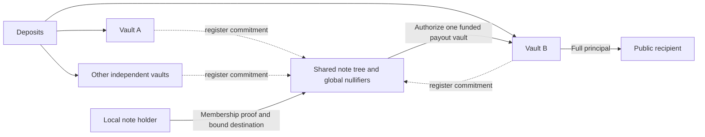

# Privacy model and distributed custody

## Settlement structure

Each reviewed group has independent keyless vaults and one immutable forest. Deposit principal stays in the selected vault; the forest maintains a shared Poseidon note tree, spent nullifiers and payout reservations. A holder proves a right in that shared tree and can withdraw from one verified vault with sufficient liquidity. The payout goes directly from that vault to the proof-bound recipient. Principal does not travel through an A → B → C chain.

Private note transfers append new commitments without moving backing between vaults. Creating more vaults distributes custody and liquidity; it does not create additional independent participants or guarantee a larger effective anonymity set. The current tree supports 256 total outputs, including transfers, per group. Separate groups and assets are separate proof domains.



## What is hidden and visible

Groth16 proves membership and correct spending without naming the input commitment in the withdrawal. Global nullifiers prevent the same note being paid twice. The action context binds the vault, recipient and disclosure reference; retries retain that original destination.

Public observers can still see deposited commitments, vault funding and balances, transaction signers, token/denomination, payout vault, recipient, amounts, timing, nullifiers and disclosure references. NEAR cross-contract receipts are public. A small group, address reuse, matching timing, funding provenance or voluntary disclosures can correlate deposits and payouts. The protocol does not measure an effective anonymity set, generate recipient EOAs automatically, hide all transaction metadata or provide network-layer anonymity. More public hops alone would not remove these signals.

The read-only API, RPC provider, hosting provider and holders of a signed invoice may observe additional associations. The API has no settlement signing authority, but its observation of lookup metadata is still a privacy boundary. A fragment checkout link keeps terms out of the initial HTTP URL request; page code, extensions and link holders can read them.

## Invoice terms v2

New invoices contain a fresh signing nonce and one distinct random 32-byte `paymentNonces` entry per fixed-denomination unit. The merchant signs all terms, including the ordered nonce list. Given canonical parsed terms:

```text
invoiceHash = SHA256("core:invoice:v2|" + canonical(invoice))
paymentRoot[i] = SHA256("core:invoice:payment:v2|" + invoiceHash + "|" + paymentNonces[i])
```

Each proof uses its selected `paymentRoot[i]` as `disclosure_root`. Different units no longer publish a shared invoice root. The signed invoice ID/hash and full nonce list are not added to settlement calls. This removes a direct common identifier; a reused recipient, matching amount and timing can still associate the payments. Anyone with the invoice or its status request can derive the entire reference set. Status queries give that set's derivation inputs to the API. This is not a zero-knowledge invoice reconciliation service.

Invoice terms v1 remain readable with their original common root. Terms v2 retain the NEP-413 **signing envelope v1** (`core.invoice.v1`, message `Core invoice v1`); the versioned digest authenticates the new terms. The contract ABI, circuit and note domains do not change.

Checkout checks fresh indexed status before importing/signing a new payment, rejecting a reference already observed as paid. These references are not reserved or enforced as single-use on chain. Lag or simultaneous payers can reuse one reference with different nullifiers. Those are real payments: reconciliation counts them and reports `reusedPaymentReferences`. It does not discard money to preserve a preferred privacy claim. Recovery retains the original reference and recipient, including after invoice expiry.

V2 reconciliation scans a consistent recipient-history snapshot and filters the signed-derived references. Scans are bounded to 20 pages of 50 records. If coverage is incomplete, the status is `review_required`; a high-volume recipient may require a more scalable reconciliation service. An index checkpoint never asserts latest-chain freshness.

## Evidence and limits

Existing salted receipt commitments support selected field openings. Finalized evidence checks selected public transaction records. Neither establishes that every company transaction was disclosed, that a merchant is KYB-verified, or that a tax return is accepted. Keep legal names, payroll documents and statutory forms in separately encrypted business-document storage; such a provider is not implemented here. Sharing evidence can intentionally reveal associations to its recipient.

This is a local/testnet hackathon implementation with a development trusted setup and no production security audit. Public deployment, larger trees, browser proof generation, scalable private reconciliation and real KYB/tax integrations remain separate work. See [invoice behavior](INVOICES.md), [index coverage](INDEXER.md) and the [contract specification](https://github.com/Company-privacy-settlement/Contract/blob/main/docs/SHARED.md).
